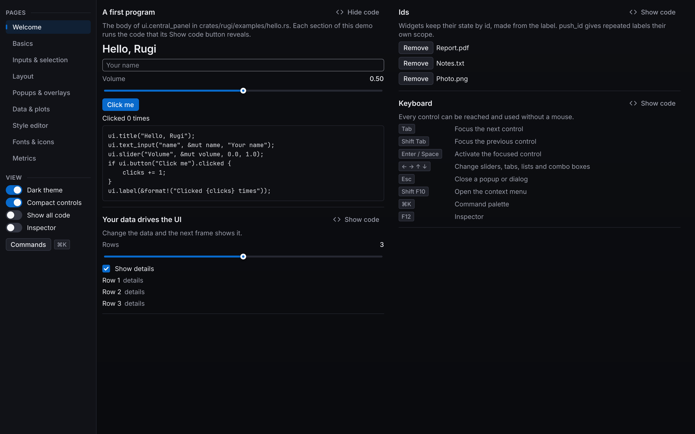
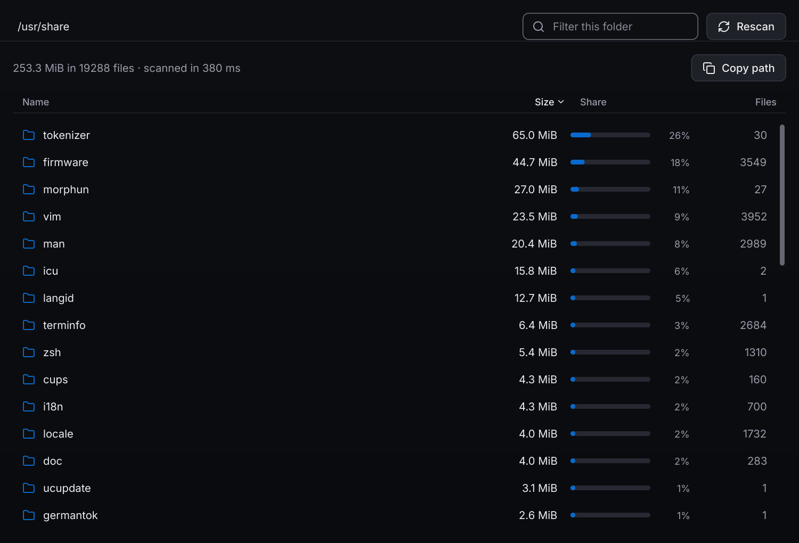
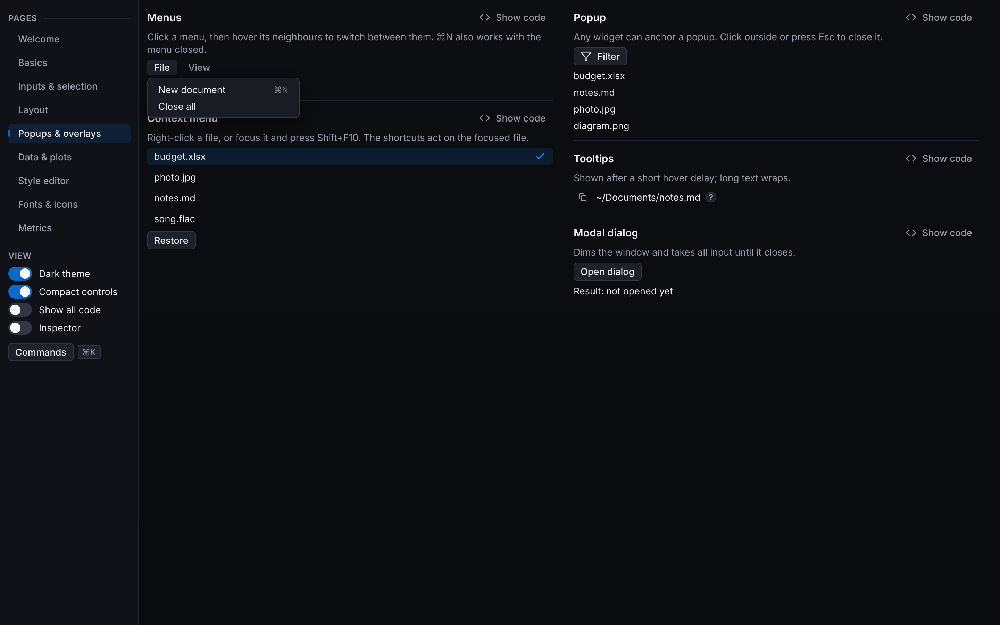
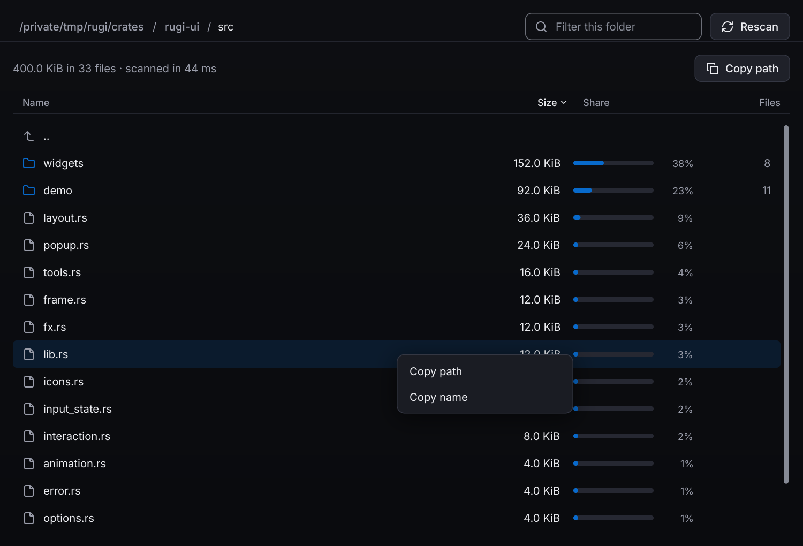
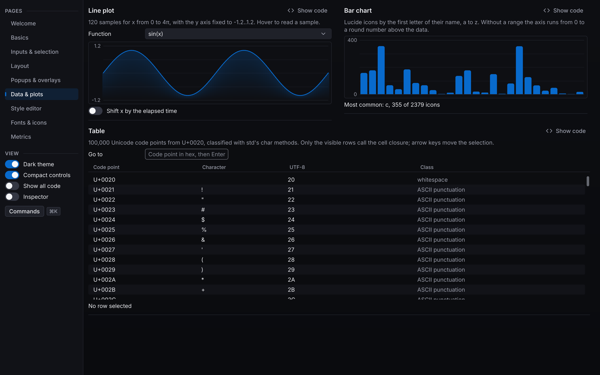
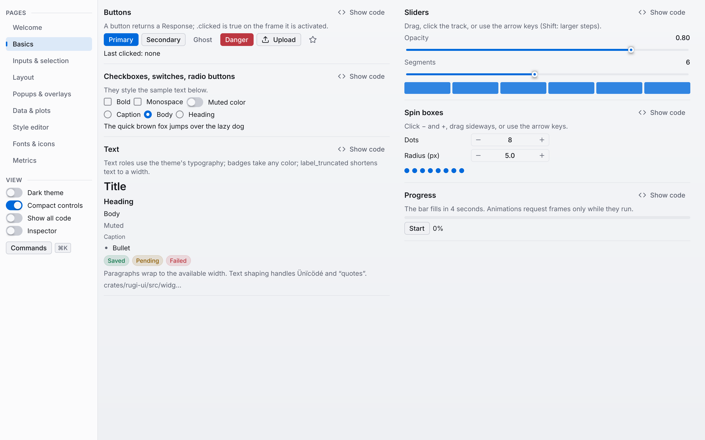

# Rugi

[](https://github.com/itzSecretProject/rugi/actions/workflows/ci.yml)
[](#license)

Rugi is a GPU-accelerated immediate-mode GUI framework written in Rust, with
C and C++ APIs. The application owns its data and rebuilds the UI every
frame, the model popularized by Dear ImGui. The widget set targets desktop
tools: tables, menus, dialogs, a command palette, a live inspector and
theming. Everything is drawn as instanced SDF primitives through wgpu.

Rugi is young (0.1): the API can still change between minor versions. It is
developed and tested on macOS; Windows and Linux builds compile, and CI is
set up to build and test them, but they have not been run on real hardware
yet.

| | |
|---|---|
| <br>Built-in demo: each section shows the code it runs | <br>Disk usage example, scanning a real folder |
| <br>Menus, context menus and popups | <br>Virtualized list with a context menu |
| <br>Plots and a 100,000-row table | <br>Light theme |

The screenshots are rendered offscreen by the engine on an Apple M1 (the demo
at 2x scale, the examples at 1.5x), using each example's `--screenshot` mode. Clicks, typing and hover are
replayed through the normal input path.

## Using Rugi in your project

Rust (1.90 or later):

```bash
cargo add rugi
```

```rust
fn main() -> Result<(), rugi::RunError> {
    let mut clicks = 0;
    rugi::run(rugi::AppOptions::default(), move |ui: &mut rugi::Ui| {
        ui.central_panel(|ui| {
            ui.title("Hello, Rugi");
            if ui.button("Click me").clicked {
                clicks += 1;
            }
            ui.label(&format!("Clicked {clicks} times"));
        });
    })
}
```

`rugi::run` opens a window and owns the event loop. To draw Rugi inside an
application that already has a winit event loop and a wgpu device (a game, a
3D tool), use `rugi::WinitInput`, `rugi::Ui` and `rugi::render::Renderer`
directly; [crates/rugi/examples/integration.rs](crates/rugi/examples/integration.rs)
does this in about 200 lines. `rugi::wgpu` and `rugi::winit` re-export the
versions Rugi is built against.

C and C++ (CMake 3.20+, a C++17 compiler for the wrapper, and a Rust
toolchain, which CMake calls to build the library):

```cmake
include(FetchContent)
FetchContent_Declare(rugi GIT_REPOSITORY https://github.com/itzSecretProject/rugi GIT_TAG v0.1.0)
FetchContent_MakeAvailable(rugi)

add_executable(app main.cpp)
rugi_link_executable(app)   # links rugi::rugi, sets the rpath, copies the DLL on Windows
```

```cpp
#include <rugi/rugi.hpp>

int main() {
    rugi::run_app({"My tool"}, [&](rugi::Ui ui) {
        ui.central_panel([&] {
            ui.title("Hello, Rugi");
            if (ui.button("Save")) { /* ... */ }
        });
    });
}
```

`add_subdirectory(rugi)` works the same way. The C header is
`include/rugi/rugi.h`; its rules (ownership, errors, threads) are in
[docs/c-abi.md](docs/c-abi.md).

On Linux, Rugi needs the usual X11 or Wayland libraries and a Vulkan or
OpenGL driver; building from source also needs `libxkbcommon-dev`,
`libwayland-dev` and `libfontconfig1-dev` (Debian and Ubuntu names).

## Trying the examples

From a clone of this repository:

```bash
cargo run -p rugi --example hello        # the smallest program
cargo run -p rugi --example integration  # Rugi inside your own wgpu app
cargo run --release -p rugi-demo        # the built-in demo: every widget, with its source
cargo run --release -p disk-usage -- ~  # what takes the space in a folder
cargo run --release -p effects           # glass panels and animated backdrops
```

The C and C++ examples (CMake builds the Rust library through cargo):

```bash
cmake -S . -B build -DCMAKE_BUILD_TYPE=Release
cmake --build build
./build/rugi_cpp_demo --showcase        # the built-in demo through the C ABI
ctest --test-dir build --output-on-failure
```

Run the test suite with `cargo test --workspace`. Build profiles, command-line
options and the headless screenshot mode are described in
[docs/building.md](docs/building.md).

## Example

```rust
use rugi::{lucide, ButtonKind, Color};

fn main() -> Result<(), rugi::RunError> {
    let mut backend = 0;
    let mut gain = 0.5;
    rugi::run(rugi::AppOptions::default(), move |ui: &mut rugi::Ui| {
        ui.side_panel(220.0, |ui| {
            ui.nav_item("Home", Some(lucide::HOUSE.into()), true);
        });
        ui.central_panel(|ui| {
            ui.title("Hello");
            if ui.button_ex("Save", ButtonKind::Primary, Some(lucide::SAVE.into())).clicked {
                // save
            }
            ui.tooltip("Writes the project to disk");
            ui.combo_box("backend", &mut backend, &["Vulkan", "Metal", "DX12"]);
            ui.with_style(|t| t.palette.accent = Color::hex(0xF7648E), |ui| {
                ui.slider("Gain", &mut gain, 0.0, 1.0);
            });
        });
        if let Some(i) = ui.command_palette(&[("New file", "Cmd+N"), ("Toggle theme", "")]) {
            // run command i
        }
    })
}
```

The C++ wrapper mirrors this API; see [docs/c-abi.md](docs/c-abi.md) and
[examples/cpp-demo/main.cpp](examples/cpp-demo/main.cpp).

## Features

- Widgets: buttons, labels, checkboxes, toggles, radio buttons, float and
  integer sliders and spin boxes, text input, combo and list boxes, tabs,
  collapsing sections, tree nodes, color picker, line and bar plots, progress
  bars, and a virtualized table.
- Layout: panels, rows (optionally centered on the cross axis), columns,
  scroll areas; text that does not fit ends in an ellipsis.
- Keyboard and accessibility: every widget is reachable with Tab and usable
  from the keyboard, and the built-in themes meet WCAG 2.2 AA contrast. There
  is no screen-reader support yet.
- Overlays: menu bar, dropdown and context menus, tooltips, modal dialogs.
  Input under an open overlay is blocked.
- Tools: fuzzy command palette and a live inspector with a performance HUD.
- Styling: one theme object (palette, metrics, typography, motion), dark,
  light and four preset themes, scoped overrides.
- Text and icons: Inter and JetBrains Mono bundled, any TTF/OTF at runtime,
  2,379 Lucide icons usable inside any label.
- Effects: glass panels with backdrop blur and refraction, six animated GPU
  backdrops, screen transitions, borderless windows with a custom title bar.
- Motion: time-based animations that settle in the same time at any refresh
  rate.
- C ABI (107 functions) and a header-only C++17 wrapper.

The full list is in [docs/features.md](docs/features.md).

## Performance

On an Apple M1, building one frame of the benchmark workload (rows of four
widgets) takes about 6 µs of CPU time for 20 rows and about 45 µs for 1,000
rows. GPU timings, a comparison with Dear ImGui on the same workload (and why
it only compares CPU work), and the method are in
[docs/benchmarks.md](docs/benchmarks.md).

Rugi itself makes no heap allocations per frame (enforced by a test); what the
application allocates in its own code is up to it. It renders nothing while
idle: frames are produced on input or while something animates.

## Documentation

- [Building and running](docs/building.md): profiles, demo options, tests
- [Features](docs/features.md): widgets, overlays, styling, demo pages
- [Architecture](docs/architecture.md): crates, frame lifecycle, state, layout, rendering
- [C ABI](docs/c-abi.md): ownership, strings, errors, threads, callbacks, versioning
- [Custom chrome and glass](docs/custom-ui.md): glass, backdrops, borderless windows, title bars
- [Benchmarks](docs/benchmarks.md): CPU, GPU, pacing and build times, with method

## Platform support

| Platform | Status |
|---|---|
| macOS (Metal) | Built, run and tested |
| Windows (x86_64) | Compiles without warnings; CI is set up to build and test it; not yet run on real hardware |
| Linux (x86_64) | Compiles without warnings; CI is set up to build and test it; not yet run on real hardware |

Rendering goes through wgpu (DX12, Vulkan, GL, Metal) and windowing through
winit. On Windows, CMake copies `rugi_ffi.dll` next to the executables.

Known limitations and planned work:

1. Windows and Linux: run and test DPI, IME and clipboard on real hardware.
2. Embedding from C and C++ into an engine or editor that owns its own
   D3D11, D3D12, Vulkan or GL device. From Rust this works today through
   `render::Renderer`; the C ABI has no renderer entry point yet.
3. Multi-line text editor, docking and splitters, native file and color
   dialogs, submenus.
4. Accessibility (AccessKit), IME composition, drag and drop, multiple windows.
5. Flexbox-style layout (Taffy); sortable headers and per-column alignment in
   `Ui::table` (the disk-usage example draws its own list for that reason).
6. GPU fill cost: specialize the main shader further and draw the opaque
   background as the clear color. Frames with glass render offscreen and pay
   for one full-screen copy.
7. Transparent windows were tested headlessly only; the live
   borderless/transparent path has not been checked on every OS compositor.
8. 120/144 Hz displays: the pacing code follows the monitor, but only a 60 Hz
   panel was available for testing.

## How it was made

Rugi was written in November 2026 with AI assistance (Claude, through Claude
Code). The author chose the design, directed the work and reviewed the
changes, and the project was checked with the tools it ships: the test suite,
the fuzzer, the sanitizer runs against the C ABI, the contrast and keyboard
tests, and the benchmarks in [docs/benchmarks.md](docs/benchmarks.md).

The first public release is a single commit. Later changes are recorded commit
by commit. [Platform support](#platform-support) says what has and has not
been run on real hardware.

## Contributing

Bug reports and pull requests are welcome; see
[CONTRIBUTING.md](CONTRIBUTING.md) for how to build, test and what CI
checks. Security issues: see [SECURITY.md](SECURITY.md).

## License

Rugi is licensed under either of

- Apache License, Version 2.0 ([LICENSE-APACHE](LICENSE-APACHE))
- MIT license ([LICENSE-MIT](LICENSE-MIT))

at your option.

Unless you explicitly state otherwise, any contribution intentionally
submitted for inclusion in the work by you, as defined in the Apache-2.0
license, shall be dual licensed as above, without any additional terms or
conditions.

The bundled fonts (Inter, JetBrains Mono) are under the SIL Open Font License
1.1 and the Lucide icons under ISC; dependencies are under permissive
licenses. See [THIRD_PARTY_NOTICES.md](THIRD_PARTY_NOTICES.md).
