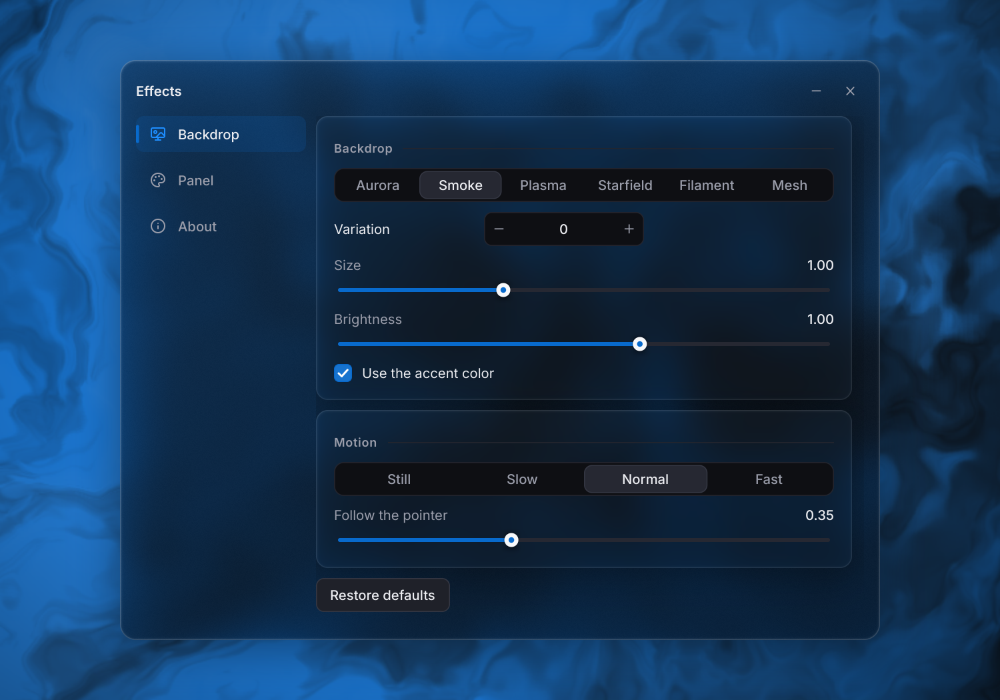
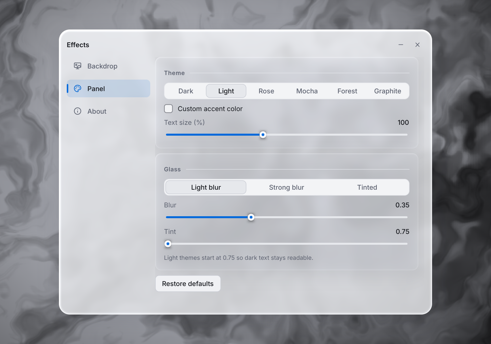
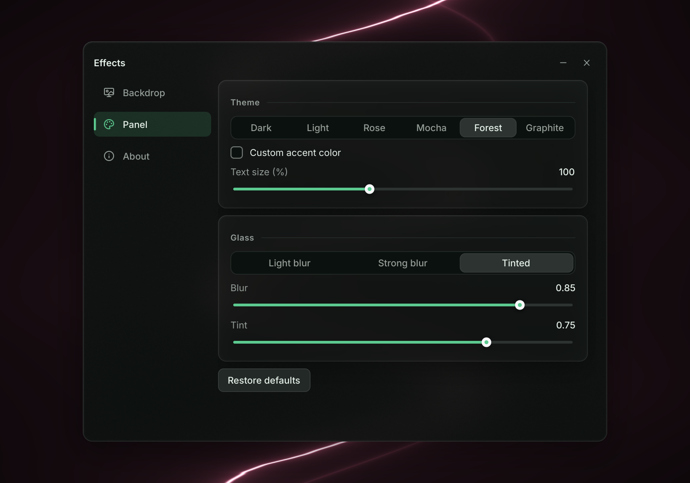
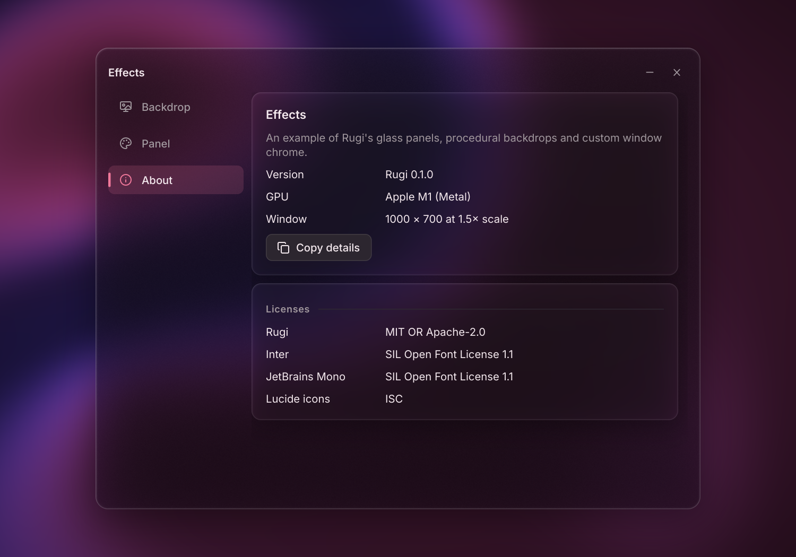

# Custom chrome and glass

This guide covers the parts of Rugi for hand-styled interfaces: glass
panels, animated GPU backdrops, borderless windows with custom chrome, and a
few widgets that suit them. None of them require shader code, images or
extra crates.

The `effects` example uses all of them: a glass panel in a borderless window
over one of the procedural backdrops. The Backdrop page changes the backdrop
behind the panel, the Panel page the theme and the glass of the panel itself,
and About lists the build, the GPU and the licenses. Every control applies at
once.

```bash
cargo run --release -p effects     # Rust
./build/rugi_cpp_glass             # the same example in C++ (after the CMake build)
```

| | |
|---|---|
| <br>Backdrop page: Smoke in the accent color | <br>Light theme, "Light blur" glass over Smoke |
| <br>Forest theme, "Tinted" glass over Filament | <br>About page: version, GPU, window size and licenses |

The images are the example's `--screenshot` output at 1.5× scale:

```bash
cargo run --release -p effects -- --screenshot docs/screenshots/effects.png --scale 1.5 --backdrop smoke --click "Use the accent color"
cargo run --release -p effects -- --screenshot docs/screenshots/effects-light.png --scale 1.5 --page panel --theme light --backdrop smoke --glass "light blur"
cargo run --release -p effects -- --screenshot docs/screenshots/effects-tinted.png --scale 1.5 --page panel --theme forest --backdrop filament --glass tinted
cargo run --release -p effects -- --screenshot docs/screenshots/effects-about.png --scale 1.5 --page about --theme rose --backdrop plasma
```

## Building blocks

### Animated backdrops

```rust
ui.backdrop(&Backdrop::new(BackdropKind::Smoke));          // fills the window; call first
ui.backdrop_rect(card_rect, 22.0, &Backdrop::new(BackdropKind::Mesh).with_seed(3.0)); // a rounded area
```

There are six backdrops, all evaluated on the GPU:

| Backdrop | Look | Rendered at |
|---|---|---|
| `Aurora` | aurora curtains | half resolution |
| `Smoke` | domain-warped ink | half resolution |
| `Plasma` | sine plasma | half resolution |
| `Starfield` | twinkling drifting stars | full resolution (thin detail) |
| `Filament` | glowing electric line | full resolution (thin detail) |
| `Mesh` | moving mesh gradient with grain | half resolution |

A `Backdrop` sets the base and accent colors, scale, speed, intensity, seed
and how strongly it reacts to the pointer. The shader's clock is the UI time
multiplied by `speed`, so changing the speed moves the pattern to another
point of its animation.

An animated backdrop requests frames at the ambient rate
(`ui.set_ambient_rate(AmbientRate { focused, unfocused })`). The default is
the display refresh rate while the window is focused and 30 fps while
another window has focus. Interaction and widget animations always get
full-rate frames. With `speed: 0.0` the UI returns to idle (no CPU or GPU use
while nothing changes).

### Glass

```rust
ui.glass(rect, &GlassStyle::frosted());                    // a surface
ui.begin_glass_panel(rect, &GlassStyle::frosted()); /* widgets */ ui.end();  // floating panel
ui.glass_card(&style, |ui| { /* widgets */ });             // card sized by its content
```

Glass shows a blurred copy of everything drawn before it:

1. When the renderer reaches a glass primitive with new content behind it,
   it snapshots the frame.
2. It builds a blur mip chain from that snapshot (13-tap downsample per
   level).
3. Glass samples the chain with:
   - tint and saturation;
   - refraction and chromatic dispersion at the rim (when `refraction > 0`);
   - a directional rim light;
   - film grain.

Three presets fill a `GlassStyle`: `frosted` (strong blur), `liquid` (light
blur with rim refraction) and `smoked` (dark tint). Every field is public;
the example starts from a preset and sets `blur` and `tint` from its
sliders, with the tint taken from the theme background so text stays
readable. Nested glass (cards inside a glass panel) works: each level blurs
what lies beneath it, with up to 8 snapshots per frame.

When you render into your own wgpu render pass (`Renderer::render`), the
engine cannot take snapshots, so glass falls back to its tint. The normal
runner, the headless runner and `Renderer::render_to_view` support the full
effect.

### Window chrome

```rust
AppOptions { decorations: false, transparent: true, resizable: false, .. }
ui.title_bar("Settings", 30.0);       // title + minimize + close; empty area drags the window
ui.window_command(WindowCommand::ToggleMaximize);
```

A borderless window with `transparent: true` can be rounded: paint
`ui.backdrop_rect(screen, 20.0, ..)` and leave the corners empty.

The runner turns on `Ui::set_transparent_canvas`, so the theme background is
not painted. On macOS the compositor expects straight alpha
(`PostMultiplied`), so the renderer un-premultiplies the final image and
antialiased edges and shadows keep their brightness; a GPU test covers this.
Run with `RUGI_PACING_LOG=1` to print the surface format and alpha mode the
app chose.

### Widgets

| Call | What it does |
|---|---|
| `nav_item(label, icon, selected)` | Sidebar entry; items in one container share a spring-animated highlight. |
| `segmented(id, &mut usize, labels)` | Pill segmented control with a gliding selection. |
| `slider_int(label, &mut i32, min, max)` | Integer slider. |
| `spin_box_int(label, &mut i32, min, max, step)` | Integer field with − / + steppers. |
| `horizontal_centered(f)` | Row whose items are centered vertically, e.g. a label next to a spin box. |
| `rail_item(id, icon, selected, tooltip)` | Icon-only navigation (vertical or horizontal rails). |
| `multi_select(label, &mut [bool], items)` | Drop-down with checkmarks; the closed box shows the first item and a count. |
| `carousel(id, count, &mut index, size, paint)` | Centered card with shrinking, overlapping neighbours. Supports click, drag, scroll and ←/→; you paint each card. |
| `page_dots(id, count, &mut index)` | Page indicator; the current dot is a pill. |
| `icon_button(id, icon, size, tooltip)` | Ghost icon button. |
| `text_centered(text, role)` | Text centered in a full-width row. |
| `begin_transition(id, key, Slide)` | The content fades and slides in whenever `key` changes (pages, screens). |
| `spring_value` / `animate_value` | Animation helpers for your own widgets. |

### Themes

`Theme::{rose, mocha, forest, graphite}` complement `dark` and `light`. To
derive a full theme from three colors, use `Theme::dark_tinted(name,
background, text, accent)`. `Theme::set_accent` and `Theme::scale_text`
change the accent and the text size of any theme.

### Fonts and icons

2,379 Lucide icons (ISC) are built in. Any other font, including icon fonts
such as Font Awesome or Remix Icon, loads with `ui.add_font_file(path)` (check
the font's license). Pass icon glyphs as `IconRef::Glyph(&str)` or put the
`\u{...}` codepoint inside a label.

## C and C++

Everything above except the integer slider, the integer spin box and the
centered row is available through the C ABI (v3), and the C++ wrapper adds
RAII scopes:

```cpp
RugiBackdrop bg = rugi::backdrop_preset(RUGI_BACKDROP_SMOKE);
RugiGlassStyle glass = rugi::glass_style(RUGI_GLASS_FROSTED);

ui.backdrop(bg);
ui.glass_panel(rugi::rect(40, 40, 760, 580), glass, [&] {
    ui.title_bar("Settings", 30);
    ui.segmented("pages", page, {"Backdrop", "Panel", "About"});
    ui.glass_card(card, [&] {
        ui.slider("Size", bg.scale, 0.5f, 2);
        ui.slider("Brightness", bg.intensity, 0.2f, 1.5f);
    });
});
```

See [examples/cpp-glass/main.cpp](../examples/cpp-glass/main.cpp) for the
whole app. It switches pages with a segmented control instead of a sidebar,
and picks the accent and text size from fixed choices, because the C ABI has
no fixed-width column or color editor.

## GPU cost

GPU timings are from an Apple M1, with 300 frames rendered back to back. The
full method and table are in [benchmarks.md](benchmarks.md#effects-backdrops-and-glass).

| Scene | 1280×800 px | 2560×1600 px |
|---|---:|---:|
| 50 widgets, no effects | 0.49 ms | 1.57 ms |
| + full-window Smoke backdrop | 0.95 ms | 3.45 ms |
| + backdrop and 3 glass panels | 1.82 ms | 6.89 ms |
| + backdrop and 6 nested glass panels | 2.01 ms | 7.67 ms |

The heaviest scene at 2560×1600 fits in a 120 Hz frame (8.3 ms) on this GPU,
with little headroom; on larger displays or slower GPUs, use fewer stacked
glass layers. Presentation at 120 Hz has not been measured because no 120 Hz
display was available.

## Origin of the designs

The visual targets came from four public repositories: `meowsilk/custom-ui1`,
`meowsilk/imgui-1`, `meowsilk/custom-loader` and `ff0l1/icon-library`. They
are C++ / Direct3D 11 projects; two are built on Dear ImGui and two on custom
engines. They were used only as references for the visual effects they show:
glass panels, animated backdrops, icon navigation, segmented controls,
multi-select and carousels.

No code, fonts, icons or images were copied. Those repositories do not
publish a license for their code, and their artwork includes third-party
art. Rugi's versions are written from scratch: glass and backdrops are WGSL
shaders, icons are Lucide (ISC), and procedural backdrops replace images.
