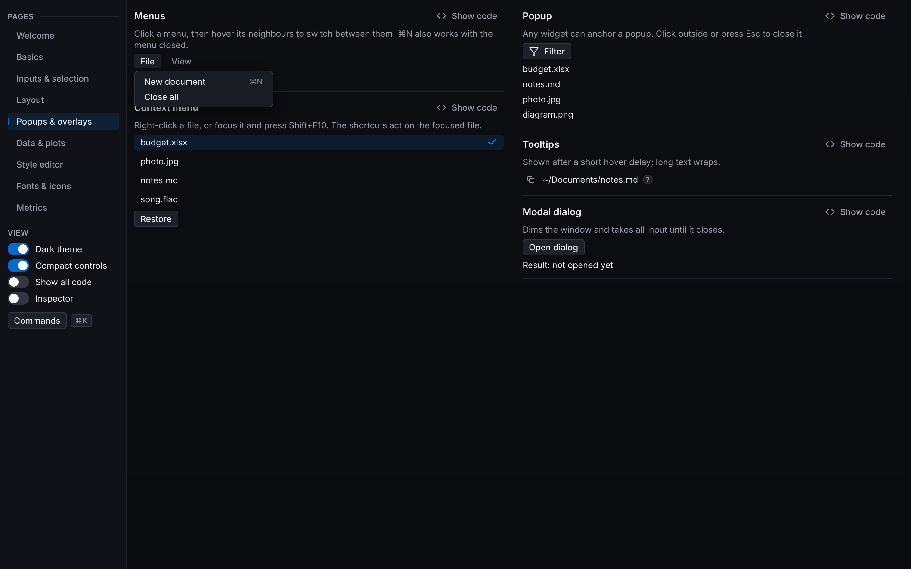
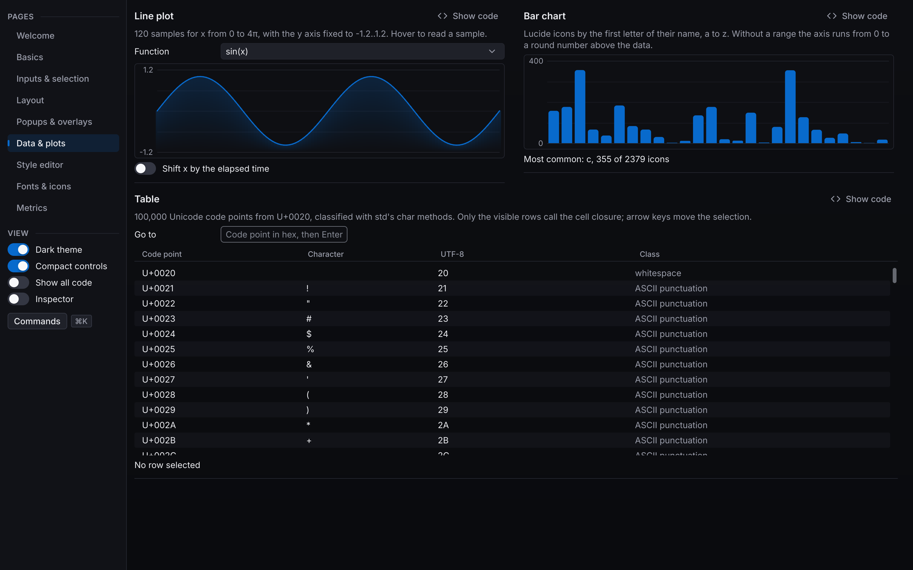
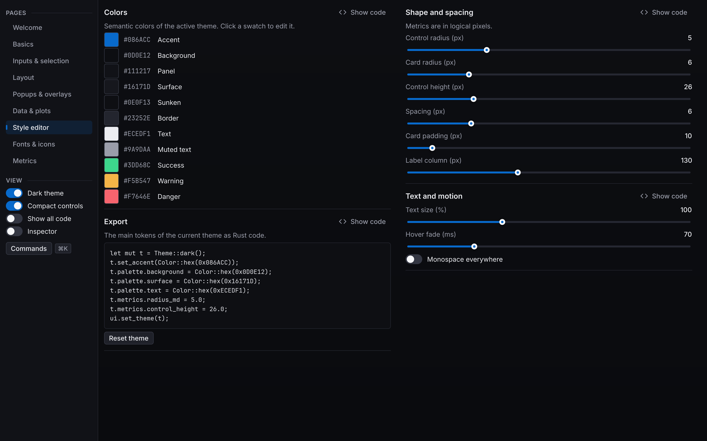
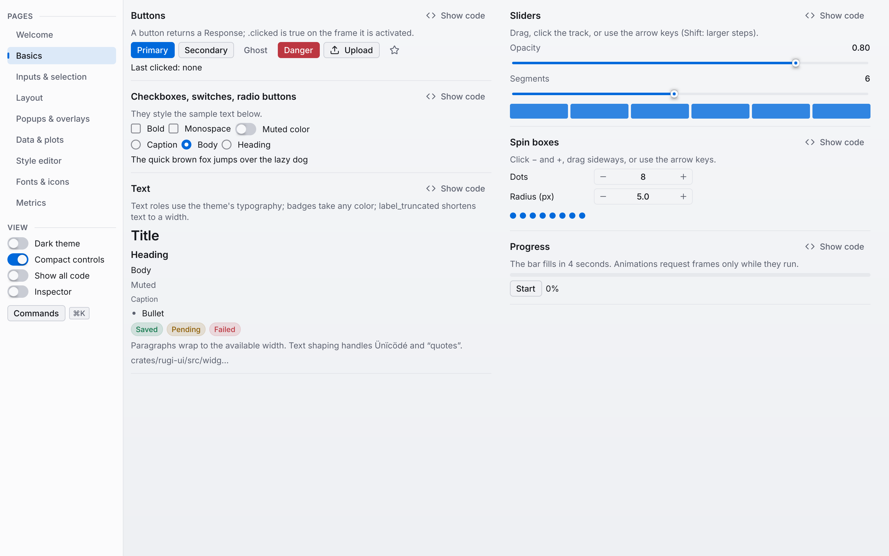
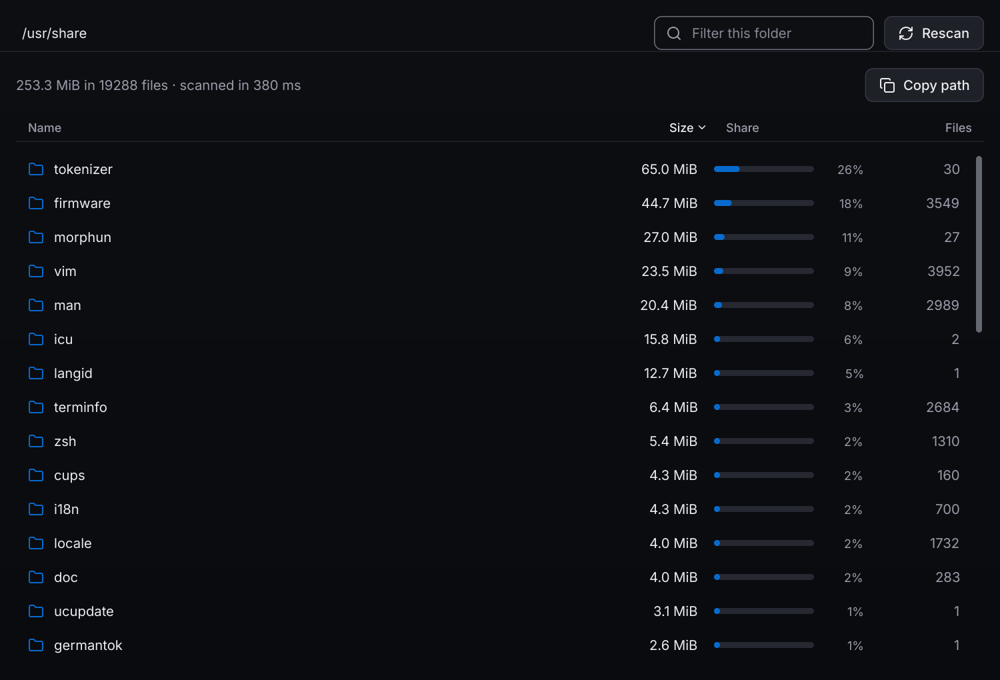
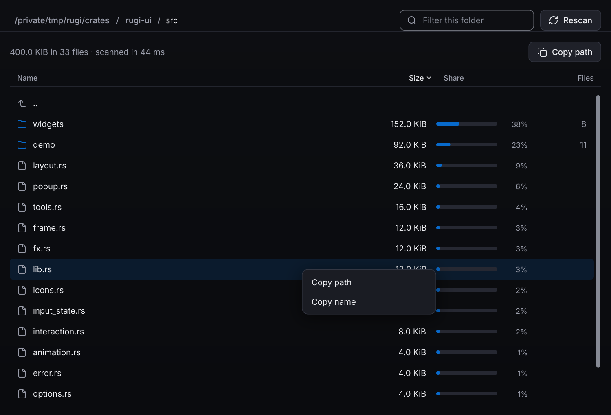

# Features

| Area | Contents |
|---|---|
| Widgets | Buttons (4 styles, optional icon), labels (wrapping, eliding, lazy `label_fmt`), bullets, help markers, separators, checkbox, toggle, radio button, slider, spin box, text input (selection, word navigation, clipboard), combo box, list box, tabs, collapsing sections, tree nodes, color picker (HSV, alpha, hex), line plot, bar chart, code block with copy button, progress bar, badge, navigation items, images, icons, selectable rows, virtualized table |
| More widgets | Shortcut editor (`keybind`: keys, combinations or mouse buttons; for push-to-talk style controls it can also report hold, toggle or always-on), multi-select, segmented control, icon rail, carousel, page dots, icon button, password input, centered text |
| Overlays | Menu bar, dropdown menus, context menus, tooltips, modal dialogs; input under an open overlay is blocked |
| Keyboard and accessibility | Every interactive widget is reachable with Tab and Shift+Tab, including widgets scrolled out of view, and is scrolled into view when focused; Enter and Space activate; Escape closes popups and returns focus to the widget that opened them. Arrow keys move through menu and combo rows, the table selection (with Page Up/Down, Home, End) and the color picker. Shift+F10 or the Menu key opens the focused widget's context menu. Built-in themes meet WCAG 2.2 AA contrast |
| Tools | Command palette with fuzzy search; live inspector (F12 or Cmd/Ctrl+Shift+I) with a performance HUD and per-widget data for tests and tooling |
| Styling | One `Theme` (palette, metrics, typography, motion); dark, light, Rose, Mocha, Forest and Graphite presets; `dark_tinted` derives a theme from three colors; accent derivation; scoped overrides (`push_style`, `with_style`) |
| Effects | Glass (blurred mip chain, tint, refraction, dispersion, rim light, grain; nestable), six animated GPU backdrops, screen transitions, borderless and transparent windows with a custom title bar |
| Fonts and icons | Inter (UI) and JetBrains Mono (code) bundled; any TTF/OTF at runtime; global font and scale switch; 2,379 Lucide icons; icon glyphs inside any label |
| Motion | Per-widget hover, press, focus and value animation; critically damped springs for indicators; all time-based, so independent of the refresh rate |
| Display | Follows the monitor refresh rate; `PresentPolicy::{Vsync, LowLatency, Uncapped}` (`LowLatency` is mailbox with one frame); measured pacing available to the app |
| C ABI | 107 functions: opaque handles, typed errors, panic-safe, thread-checked, re-entrant table and carousel callbacks, generated header |
| C++ | Header-only C++17 wrapper: RAII scopes, exception-safe callbacks, `std::string_view`, Lucide constants header |

Glass, backdrops, window chrome and these widgets are covered in
[custom-ui.md](custom-ui.md).

## Built-in demo

`ui.show_demo()` (C: `rugi_show_demo`) shows every feature, in the manner of
Dear ImGui's `ShowDemoWindow()`. Each section runs a block of code and shows
that block's source next to the widgets it produces, so the code on screen is
the code that runs. It has nine pages:

| Page | Contents |
|---|---|
| Welcome | A first program, ids, data-driven UI, keyboard shortcuts |
| Basics | Buttons, checkboxes, switches and radio buttons, sliders, spin boxes, progress, text |
| Inputs & selection | Text and password fields, combo boxes, multi-select, tabs, list boxes |
| Layout | Rows, centered rows, columns, scrolling, collapsing sections, trees |
| Popups & overlays | Menus, context menus, anchored popups, tooltips, modal dialogs |
| Data & plots | Line plot, bar chart, a 100,000-row virtualized table |
| Style editor | Every theme color and metric, with a color picker and export as Rust code |
| Fonts & icons | Type specimen, icons inside text, a searchable table of the 2,379 icons |
| Metrics | Frame build-time plot and frame statistics |

```bash
cargo run --release -p rugi-demo
./build/rugi_cpp_demo --showcase     # the same demo through the C ABI
```

| | |
|---|---|
| <br>Popups & overlays, with a menu open | <br>Data & plots |
| <br>Style editor | <br>Light theme |

## Disk usage example

`disk-usage` scans a folder on a background thread with `std::fs` and lists
what takes the space, largest first: a virtualized list with sortable columns,
a share bar per entry, a breadcrumb to move between folders, a filter, and a
context menu that copies paths. Folders it cannot read show the operating
system's error.

```bash
cargo run --release -p disk-usage -- /usr/share
```

| | |
|---|---|
| <br>`/usr/share`, sorted by size | <br>Context menu on a file |
